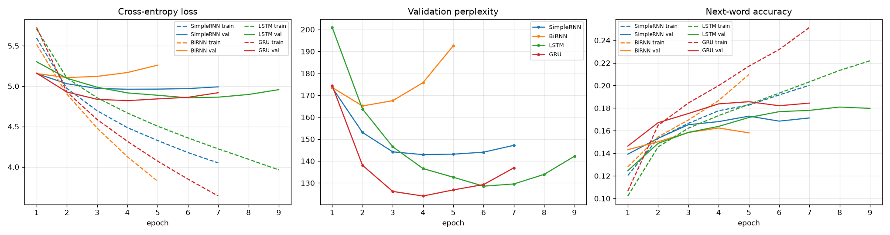
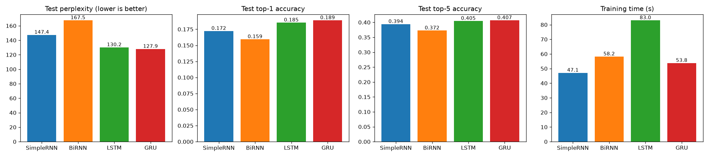
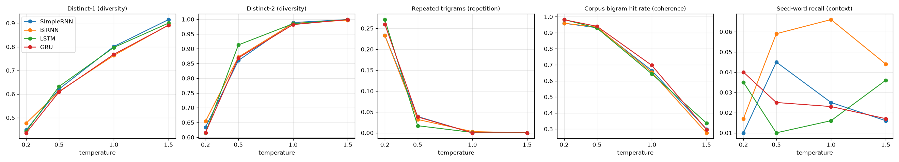

# Autoregressive Text Generation on *The Adventures of Sherlock Holmes* using Simple RNN, Bidirectional RNN, LSTM and GRU

**Course:** Foundations of Generative AI (ICT4403), Assignment 2
**Student:** Anuran Baruah
**Registration No.:** 220911544

---

## 1. Problem statement and objective

An autoregressive language model generates text one word at a time. At each step it predicts the next word from the words before it, then feeds that prediction back in as input.

The goal of this project is to:

1. build a word-level next-word prediction system on a literary text corpus,
2. implement **Simple RNN, Bidirectional RNN, LSTM and GRU** models and train them under the same experimental conditions,
3. compare them using quantitative metrics (loss, perplexity, accuracy, training time) and qualitative properties of the generated text (coherence, diversity, contextual consistency, repetition),
4. study how the **sampling temperature** affects generation and decide which model works best for this dataset.

## 2. Dataset

| | |
|---|---|
| **Name** | *The Adventures of Sherlock Holmes* by Arthur Conan Doyle (1892) |
| **Source** | Project Gutenberg, eBook #1661: https://www.gutenberg.org/ebooks/1661 |
| **Plain-text file used** | https://www.gutenberg.org/cache/epub/1661/pg1661.txt (copy in [`data/sherlock_holmes.txt`](data/sherlock_holmes.txt)) |
| **Licence** | Public domain (Project Gutenberg licence) |

**Characteristics** (after removing the Project Gutenberg header, footer and table of contents)

* 12 short detective stories narrated by Dr. Watson, written in late-Victorian English prose
* 561,660 characters, 104,423 words, about 5,100 sentences (around 20 words per sentence)
* A lot of dialogue (`?` alone appears 738 times) and recurring characters (Holmes, Watson, Lestrade)
* 120,534 tokens after tokenisation, with 8,017 unique tokens. 3,571 of these appear only once, so the word frequencies follow a Zipf-like long tail (see `results/plots/dataset_word_frequency.png`).

## 3. Pre-processing and sequence construction

1. Curly quotes and apostrophes are normalised, and em-dashes, hyphens and `_italic_` markers are replaced by spaces.
2. The text is lower-cased.
3. The text is split into words, keeping internal apostrophes such as `don't`. The punctuation marks `. , ? ! ; :` become separate tokens so the model learns sentence boundaries. Quotation marks are removed.
4. The vocabulary contains every token that appears at least twice: **4,448 tokens**, including `<pad>` and `<unk>`. Rarer words become `<unk>`, which affects 2.96 % of tokens.
5. The token stream is split **in order** into 80 % train, 10 % validation and 10 % test. Splitting in order means overlapping windows cannot leak between the splits.
6. A sliding window of **15 tokens** is the input and the **16th token is the target**:
   `[t1 … t15] → t16`, `[t2 … t16] → t17`, …
   This gives 96,412 training, 12,038 validation and 12,039 test sequences.

```
i . a scandal in bohemia i . to sherlock holmes she is always the  --> woman
. a scandal in bohemia i . to sherlock holmes she is always the woman  --> .
```

## 4. Models

All models have the same structure. Only the recurrent block changes:

`Embedding(128)` → **2-layer recurrent block, 256 hidden units, dropout 0.3** → `Dropout(0.3)` → `Linear(vocabulary)`

| Model | Recurrent block | Parameters |
|---|---|---|
| Simple RNN | `nn.RNN` (tanh). A plain recurrence that is prone to vanishing gradients | 1.94 M |
| Bidirectional RNN | `nn.RNN(bidirectional=True)`. It reads the 15-token **input window** in both directions and concatenates the final forward and backward states. It never sees the target word, so it is still a valid next-word predictor | 3.44 M |
| LSTM | `nn.LSTM`. Input, forget and output gates plus a separate cell state | 2.63 M |
| GRU | `nn.GRU`. Update and reset gates, lighter than the LSTM | 2.40 M |

Each model predicts the next word from the final hidden state of its last layer (many-to-one).

**Common training setup:** cross-entropy loss, Adam (learning rate 0.001), batch size 128, gradient clipping at 5, up to 25 epochs with early stopping on validation loss (patience 3, best weights restored), and the same random seed (42) and data order for every model. Training ran on an NVIDIA GTX 1650 GPU.

**Generation:** the seed text is tokenised, the model samples the next word from `softmax(logits / T)`, the word is appended, and the last 15 tokens are fed back in. `<unk>` is never sampled. Every model uses the **same 5 seed sequences** at **4 temperatures (0.2, 0.5, 1.0, 1.5)**, with 3 samples of 50 words for each combination. Greedy (argmax) decoding is also shown for reference.

## 5. Repository structure

```
├── FGAI_Assignment2_Text_Generation.ipynb   # full implementation, with all outputs
├── data/
│   └── sherlock_holmes.txt                 # dataset (Project Gutenberg #1661)
├── results/
│   ├── model_comparison.csv                # test loss / perplexity / accuracy / time
│   ├── training_history.csv                # per-epoch train & validation metrics
│   ├── generation_metrics.csv              # diversity / repetition / coherence per model & temperature
│   ├── generated_samples.txt               # readable samples (5 seeds × 4 temperatures × 4 models)
│   ├── generated_samples.csv               # all 240 generated samples
│   └── plots/
│       ├── dataset_word_frequency.png
│       ├── training_curves.png
│       ├── test_metrics.png
│       └── temperature_effects.png
├── requirements.txt
└── README.md
```

## 6. Execution steps and dependencies

**Dependencies:** Python 3.10+, PyTorch ≥ 2.6, NumPy, pandas, Matplotlib, Jupyter. A CUDA GPU is optional; on a CPU the notebook still runs, only more slowly.

```bash
# 1. clone the repository and enter it
git clone <repository-url>
cd <repository-folder>

# 2. (optional) create a virtual environment
python -m venv .venv
.venv\Scripts\activate          # Windows
# source .venv/bin/activate     # Linux / macOS

# 3. install the dependencies
pip install -r requirements.txt
# for GPU support install the CUDA build of PyTorch, e.g.
# pip install torch --index-url https://download.pytorch.org/whl/cu126

# 4. run the notebook
jupyter notebook FGAI_Assignment2_Text_Generation.ipynb
# or run it headless:
jupyter nbconvert --to notebook --execute --inplace FGAI_Assignment2_Text_Generation.ipynb
```

If `data/sherlock_holmes.txt` is missing, the notebook downloads it automatically. All files in `results/` are regenerated on every run. A full run takes about 5 minutes on a GTX 1650.

## 7. Results

### 7.1 Quantitative comparison (held-out test split)

| Model | Params | Epochs (best) | Test loss | **Test perplexity** | Top-1 acc. | Top-5 acc. | Training time | Time / epoch |
|---|---|---|---|---|---|---|---|---|
| Simple RNN | 1.94 M | 7 (4) | 4.993 | 147.4 | 17.2 % | 39.4 % | 47.1 s | 6.7 s |
| Bidirectional RNN | 3.44 M | 5 (2) | 5.121 | 167.5 | 15.9 % | 37.3 % | 58.2 s | 11.6 s |
| LSTM | 2.63 M | 9 (6) | 4.869 | 130.2 | 18.5 % | 40.5 % | 83.0 s | 9.2 s |
| **GRU** | 2.40 M | 7 (4) | **4.852** | **127.9** | **18.9 %** | **40.7 %** | 53.8 s | 7.7 s |




### 7.2 Generated text metrics (average of 15 samples per cell)

* **Distinct-1 / Distinct-2:** the share of unique words and unique bigrams. Higher means more **diverse** text.
* **Rep-3:** the share of repeated word trigrams. Higher means more **repetition**.
* **Bigram hit rate:** the share of generated word pairs that also appear in the training text. This is a proxy for local **coherence** and fluency.
* **Seed recall:** the share of the seed's content words that appear again in the continuation. This is a rough proxy for **contextual consistency**.

| Model | T | Distinct-1 | Distinct-2 | Rep-3 | Bigram hit | Seed recall |
|---|---|---|---|---|---|---|
| Simple RNN | 0.2 | 0.448 | 0.634 | 0.233 | 0.959 | 0.010 |
| | 0.5 | 0.621 | 0.860 | 0.039 | 0.931 | 0.045 |
| | 1.0 | 0.801 | 0.989 | 0.000 | 0.665 | 0.025 |
| | 1.5 | 0.915 | 0.999 | 0.000 | 0.299 | 0.016 |
| Bidirectional RNN | 0.2 | 0.477 | 0.654 | 0.233 | 0.959 | 0.017 |
| | 0.5 | 0.611 | 0.872 | 0.032 | 0.935 | 0.059 |
| | 1.0 | 0.763 | 0.986 | 0.003 | 0.654 | 0.066 |
| | 1.5 | 0.892 | 0.997 | 0.000 | 0.276 | 0.044 |
| LSTM | 0.2 | 0.443 | 0.615 | 0.271 | 0.982 | 0.035 |
| | 0.5 | 0.632 | 0.913 | 0.017 | 0.929 | 0.010 |
| | 1.0 | 0.797 | 0.985 | 0.001 | 0.644 | 0.016 |
| | 1.5 | 0.900 | 0.999 | 0.000 | 0.337 | 0.036 |
| GRU | 0.2 | 0.436 | 0.616 | 0.260 | 0.981 | 0.040 |
| | 0.5 | 0.609 | 0.869 | 0.038 | **0.940** | 0.025 |
| | 1.0 | 0.768 | 0.982 | 0.000 | **0.697** | 0.023 |
| | 1.5 | 0.891 | 0.999 | 0.000 | 0.297 | 0.017 |



### 7.3 Sample generations

**Seed:** *"the young lady was dressed in black, and her face was pale with fear as she told us"*

| T | Model | Continuation |
|---|---|---|
| 0.2 | LSTM | . i have been seen in the matter. it is a very little man, said holmes, and i have not been able to be a very little man. i have not been able to be a little. … |
| 0.5 | GRU | . and that i should do to ask a little more. but how? i asked you. i do not know that i have the pleasure. i am compelled to do my own business. in the case of the matter, said he, … |
| 0.5 | Simple RNN | , and i knew that i came to him. i am a kind of the day. you have formed my own theory. i had no doubt that i shall be the result. … |
| 1.0 | GRU | of the bride. but holmes had a stream. this had no flames replied? myself, but the inner clothes of the keenest floor the shutters. … |
| 1.5 | BiRNN | of on breakfast fate at! of glimpse, about wander people upon driving, and others shutter told making stark under this plumber … |

**Seed:** *"we took the train down to the little village, where the inspector was waiting for us at the"*

| T | Model | Continuation |
|---|---|---|
| 0.2 | GRU | time of the matter, and i have heard that i had heard the door of the sort of the sort. … i had no doubt that i had no doubt that i had |
| 0.5 | LSTM | lamp. oh, you must have been gone. i see that the lady is not. you see, said holmes as i had been seen. the gentleman was a very small man, … |
| 1.0 | LSTM | lamp light when he was already. on him of being that three been cabinet after my experience to coburg. … we shall continue it again, but what is it, said bradstreet |

All samples are in [`results/generated_samples.txt`](results/generated_samples.txt).

## 8. Model comparison and evaluation

* **GRU** achieves the best test loss (4.85), perplexity (127.9), top-1 accuracy (18.9 %) and top-5 accuracy (40.7 %). It reaches its best validation loss at epoch 4.
* **LSTM** comes very close (perplexity 130.2). Its training is about **1.5× slower** than the GRU's because each step is heavier and it needs more epochs to converge.
* **Simple RNN** is the fastest model but is clearly weaker (perplexity 147.4). With a short 15-token window, vanishing gradients hurt it less than they would on long sequences, so the gap to the gated models is moderate.
* **Bidirectional RNN** is the weakest (perplexity 167.5) even though it has the most parameters. In next-word prediction the backward pass only re-reads the same past context and adds no new information. The extra capacity speeds up memorisation, so it overfits after just 2 epochs, and it is the slowest model per epoch.
* **Overfitting:** all four models overfit quickly because the corpus is small (~96k training tokens). Training loss keeps falling while validation loss rises after epoch 2–6, so early stopping was essential.
* **Qualitative comparison (T = 0.5):**
  * The Simple RNN and BiRNN produce short, locally correct phrases with generic fillers ("a very quiet", "a very bad") and more broken fragments.
  * The LSTM produces fluent, dialogue-like text but falls into the strongest loops at low temperature ("i have not been able to be a little man").
  * The GRU gives the most natural continuations. It keeps the first-person narrative voice and the question-and-answer rhythm of the stories.
* **Contextual consistency** is limited for all models. Seed recall stays below 7 %, so consistency is mostly local and syntactic. For example, *"waiting for us at the"* is continued with a noun (door, lamp, time, street).

## 9. Sampling-temperature analysis

| Temperature | Diversity | Repetition | Coherence | Behaviour |
|---|---|---|---|---|
| **0.2** | low (distinct-1 ≈ 0.44) | high (rep-3 0.23–0.27) | very high (bigram hit 0.96–0.98) | grammatical but repetitive loops: "i have no doubt that i have …" |
| **0.5** | medium (≈ 0.62) | low (0.02–0.04) | high (0.93–0.94) | **best balance**: readable clauses, dialogue tags, varied content |
| **1.0** | high (≈ 0.78) | ≈ 0 | medium (0.64–0.70) | rich vocabulary and character names, but the grammar breaks down |
| **1.5** | very high (≈ 0.90) | 0 | low (0.28–0.34) | nearly random sequences of rare words |

* A low temperature sharpens the distribution toward frequent continuations. Local fluency improves, but the text gets stuck in repetition loops.
* A high temperature flattens the distribution. Diversity rises and repetition disappears, but the share of plausible word pairs falls sharply.
* The gated models are more confident, so at T = 0.2 they repeat slightly more than the simple RNNs. At T = 0.5 and 1.0 the **GRU** keeps the highest bigram hit rate, which means it stays the most coherent as diversity increases.
* Each model uses a fixed random stream per seed, so its continuations at different temperatures often start the same way and then drift apart. This makes the effect of temperature easy to see in `generated_samples.txt`.

## 10. Conclusion

The **GRU** is the best-performing model for autoregressive generation on *The Adventures of Sherlock Holmes*, for four reasons:

1. it has the lowest test loss and perplexity and the highest top-1 and top-5 accuracy,
2. it trains faster than the LSTM with fewer parameters,
3. it has the highest corpus bigram hit rate at T = 0.5 and T = 1.0 while keeping repetition low,
4. it produces the most coherent and stylistically consistent samples.

The LSTM is a close second. The Bidirectional RNN is the least suitable for this task: bidirectionality helps when the whole sequence is known (for example in classification or tagging), but in left-to-right generation the future words are not available, so it only adds cost and overfitting. The recommended configuration is **GRU with sampling temperature ≈ 0.5**.

**Possible improvements:**

* a larger corpus, such as the complete Sherlock Holmes canon
* longer context windows
* stronger regularisation
* pretrained word embeddings
* top-k or nucleus sampling
* a Transformer decoder for better long-range consistency
